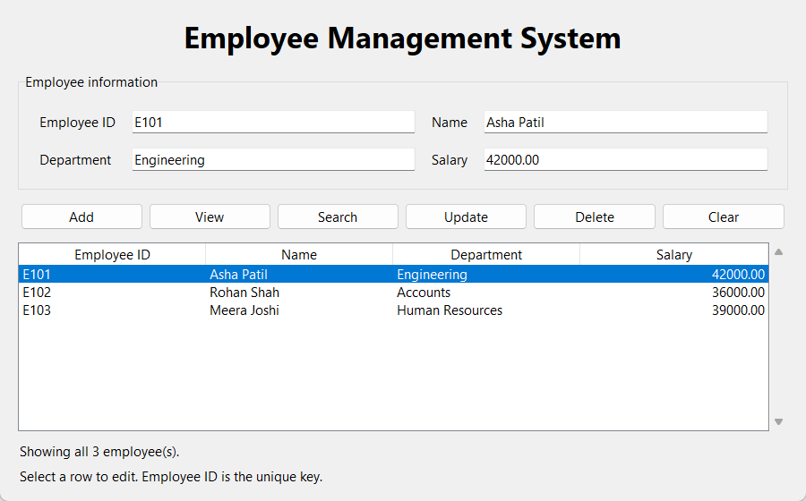

# Employee Management System

A beginner-friendly Python Programming mini-project using Tkinter and CSV files.

- **Nihar Bute** - Roll Number **09**
- **Nandini More** - Roll Number **06**
- **Subject:** Python Programming

## Run the application

Install Python 3 with Tkinter, open a terminal in this project folder, and run:

```sh
python main.py
```

On Windows, `py main.py` also works. The application uses only the Python standard
library; no pip packages are needed. If Tkinter is missing, install your operating
system's Python Tk support (for example, `python3-tk` on Ubuntu).

## How to use

1. **Add:** Fill in employee ID, name, department and salary, then click Add.
2. **View:** Click View to show all saved employees, including after a search.
3. **Search:** Enter an employee ID and click Search. The matching record appears
   in the table and its values fill the form.
4. **Update:** Search for an employee or select a table row. Keep the same ID,
   change the name, department or salary, and click Update.
5. **Delete:** Enter or select an employee ID, click Delete and confirm.
6. **Clear:** Empty the form and deselect the table row. Saved records stay intact.

Employee IDs are unique and case-sensitive. Update targets the ID currently in
the form; changing an ID is not supported as a rename operation. Salary must be a
finite, nonnegative number and is saved to two decimal places. Enter salary without
commas or currency symbols. All four fields are required for Add and Update.

## Data storage

Records are saved in `employees.csv` next to `main.py`, regardless of the terminal's
working directory. Each successful change is saved immediately. The app reloads
records when opened again. Three fictional demonstration employees are included
and shown in the screenshot; they can be deleted using the application.

The CSV columns are `Employee ID,Name,Department,Salary`. If the file is missing,
the app creates it with headings. Keep a backup before manually editing the CSV.
The folder must be writable. This simple project is intended for one running
application at a time.

## Files

```text
Employee-Management-System/
|-- main.py
|-- employees.csv
|-- README.md
|-- screenshots/
|   `-- output.png
`-- Employee_Management_System_Report.pdf
```

## Python concepts

`EmployeeApp` demonstrates a class and object. Its methods implement the GUI and
record operations. Dictionaries hold employee data; lists hold records. Loops
build the form and table, conditions select actions, `csv` handles file storage,
and `try`/`except` displays readable validation and file errors. Tkinter's event
loop handles button clicks and row selection.

## Verification performed

The application was run on Windows with Python 3.12 and Tkinter 8.6. Automated
checks invoked the actual Tkinter buttons using a separate temporary CSV. Error
dialogs and confirmation responses were controlled by the test script.

- Add and CSV read-back, including a name containing a comma: passed.
- View all records and Search by ID with form population: passed.
- Select a row, Update its department and salary, and read back saved values: passed.
- Cancel Delete, then confirm Delete: passed.
- Close the first Python process and start a new one: updated data remained and
  the deleted record stayed absent.
- Reject duplicate IDs, blank fields, missing IDs, negative and nonnumeric salary,
  NaN and infinity: passed.
- Missing records and malformed CSV headings display errors: passed.
- Simulated write failure preserves the previous CSV: passed.

The screenshot below was captured from the running Tkinter application with the
included fictional sample records; it is not a mockup.



## Project report and repository

[Download the PDF report](Employee_Management_System_Report.pdf)

[GitHub repository](https://github.com/niiharbute/Employee-Management-System)
